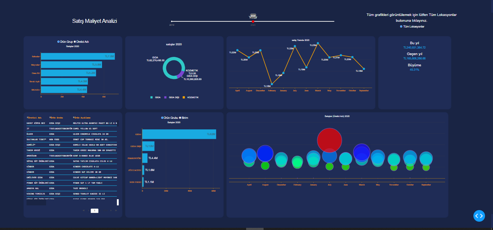

# Sales Cost Analysis — Turkish Supermarket

Exploratory analysis of a Turkish supermarket chain's sales-cost reports, plus an
interactive [Plotly Dash](https://dash.plotly.com/) dashboard for browsing sales by
year, product group, manufacturer and month.



## Overview

The project has two parts:

- **`sales-cost-analysis.ipynb`** combines the daily report exports into one table
  and explores it with pandas.
- **`dashboard/`** is a Dash app with a dark theme. It shows:
  - the top 5 product sub-groups or manufacturers by sales (bar chart)
  - the GIDA / GIDA DIŞI / KOZMETIK split (donut chart)
  - the monthly sales trend (line chart)
  - KPI cards for this year, last year and year-over-year growth
  - a sortable data table of the selected year's rows
  - the top 5 product groups or units by sales (bar chart)
  - one manufacturer's monthly sales per product group (bubble chart)

  A year slider and a location selector filter the charts. The labels are in
  Turkish because the source data is.

## Dataset

The source data is a set of CSV reports (`;`-delimited) exported from the store's
back-office system. Each report has a few header rows (report date, location,
period start/end, costing method, VAT status), followed by one row per product
with quantity, price, sales amount, unit cost, cost amount, margin and profit.

The notebook merges every report into `concat_all_files_.csv` (about 5.4 million
rows). It copies the header fields onto each row and repairs mis-encoded Turkish
characters (`þ → ş`, `ý → ı`, `Ý → I`, `Þ → Ş`). The data runs from January 2019 to
early April 2021.

> The raw reports and the combined CSV are **not included** in this repository.

Main columns: `Üretici Adı` (manufacturer), `Ürün Grubu` (product group),
`Ürün Grup` (product sub-group), `Ürün Açıklama` (description), `Birim` (unit),
`Satış Tutarı` (sales amount, TL), `Maliyet Tutar` (cost), `Kar Tutar` (profit),
`Lokasyon` (location) and `Başlangıç Tarihi` (report period start).

## Key findings (from the notebook)

- **Yearly sales:** about TL 165.8M in 2019, TL 240.9M in 2020 and TL 64.5M in
  2021. That is **+45.3%** growth in 2020 and **−73.2%** in 2021. The 2021 drop
  happens because the data stops in early April 2021, so a partial year is being
  compared with a full one.
- **Top dry-food (KURU GIDA) sub-groups in 2019:** sunflower oils (TL 1.80M),
  packaged tea (TL 1.61M), loose nuts (TL 1.16M), granulated sugar (TL 1.12M) and
  wheat flour (TL 0.66M).
- **Data quality:** the product-group field mixes overlapping and duplicate
  categories. Examples are `GIDA` vs `KURU GIDA` / `TAZE GIDA`, `GIDA DIŞI` vs
  `NON FOOD`, and `ZÜCCACIYE` vs `ZÜCCACİYE`. It also has missing values.
- **Caveat:** the exports include subtotal (`Toplamlar`) and grand-total
  (`Genel Toplam`) rows. The notebook's yearly totals count them, so its absolute
  totals are overstated. The dashboard drops these rows before aggregating.

## Setup

Requires Python 3.9+.

```bash
python -m venv .venv
source .venv/bin/activate          # Windows: .venv\Scripts\activate
pip install -r requirements-dev.txt   # or requirements.txt without the test tools
```

## Running the notebook

```bash
pip install jupyter
jupyter notebook sales-cost-analysis.ipynb
```

In the first cells, set `path` to the folder holding the CSV exports. The notebook
writes `concat_all_files_.csv` to the working directory.

## Running the dashboard

Copy (or generate) `concat_all_files_.csv` into `dashboard/`, then run:

```bash
python dashboard/index.py
```

To read the CSV from somewhere else, set `SALES_DATA_PATH`:

```bash
SALES_DATA_PATH=/path/to/concat_all_files_.csv python dashboard/index.py
```

Open <http://127.0.0.1:8050>. The full dataset is large, so the first load can take
a while.

## Project structure

```
.
├── sales-cost-analysis.ipynb   # data preparation and exploratory analysis
├── dashboard/
│   ├── index.py                # Dash app: layout, callbacks, create_app()
│   ├── sales_data.py           # loading, cleaning and aggregation (pure pandas)
│   ├── figures.py              # Plotly figure builders
│   └── assets/                 # CSS loaded automatically by Dash
├── tests/                      # pytest suite (uses a small synthetic dataset)
├── Images/                     # dashboard screenshot and exported charts
├── requirements.txt
├── requirements-dev.txt
└── pytest.ini
```

## Tests

The tests use a small synthetic dataset, so they run offline and don't need the
real data:

```bash
pytest
```

They cover data cleaning (summary-row removal, whitespace and date handling), the
aggregations (top-N, group split, monthly order, KPIs), each figure builder, and
building the app layout and callbacks.

## Author

Hanan Abbas
